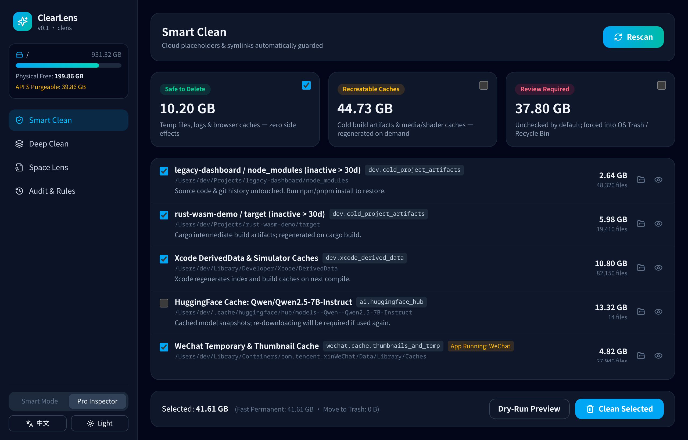
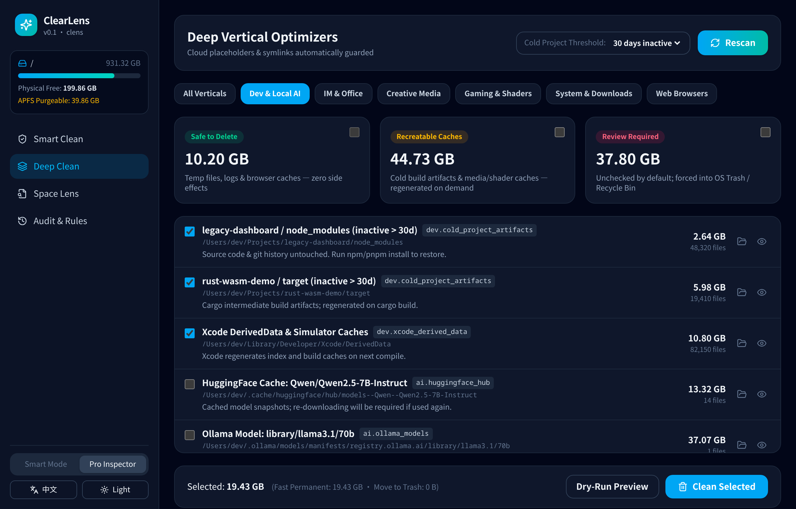
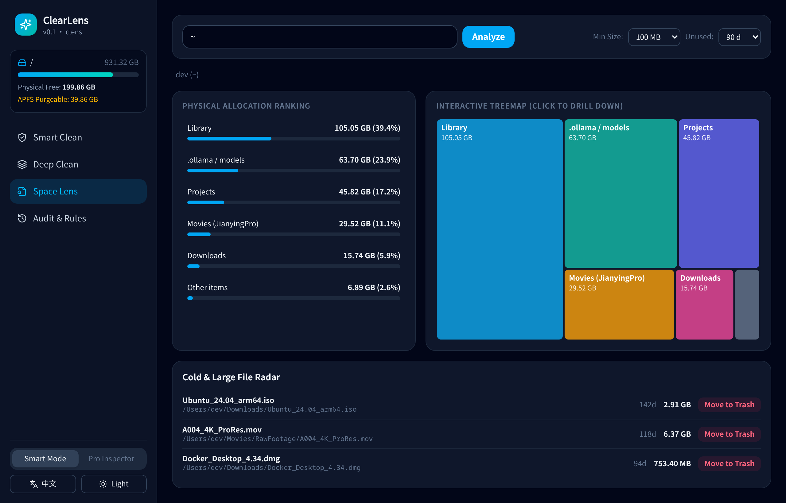
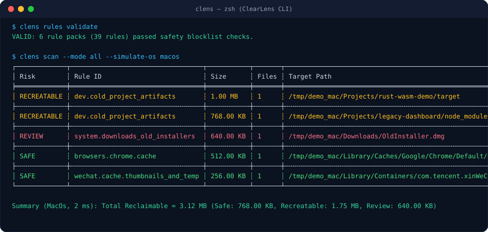

<div align="center">
  
  <h1>ClearLens (<code>clens</code>)</h1>
  <p>
    <strong>Cross-platform, open-source, transparent disk cleaner, developer/AI cache optimizer &amp; Space Lens visualizer for Windows &amp; macOS.</strong>
  </p>
  <p>
    <a href="./.github/workflows/ci.yml"></a>
    <a href="./LICENSE-MIT"></a>
    
    
  </p>
  <p>
    <strong>English</strong> | <a href="./README.zh-CN.md">简体中文</a>
  </p>
</div>

---

## Interface & CLI Preview

### Smart Clean & Pro Inspector (`Smart` ↔ `Pro` Dual Mode)
Switch seamlessly between a clean 3-tier summary for everyday cleanup and **Pro Inspector** with rule IDs, exact filesystem paths, regeneration notes, process-lock badges, and permanent ignore controls.



### Deep Vertical Optimizers (Dev / Local AI / IM / Creative / Gaming)
Targets modern multi-GB storage hogs — inactive `node_modules` / Rust `target` / `.venv` / Xcode `DerivedData`, HuggingFace & Ollama local LLM weights, WeChat/Feishu/Telegram caches (strictly preserving chat DBs & personal files), Jianying/Adobe media proxies, and Steam/DirectX shader caches.



### Space Lens & Cold File Radar
Synchronized physical-allocation directory ranking + 60fps HTML5 Canvas **Squarified Treemap** with click-to-drill-down and a **Cold & Large File Radar** to surface forgotten `.iso`, `.dmg`, and raw footage.



### `clens` Terminal CLI
Share the exact same Rust core engine and safety guardrails over the terminal, CI, or SSH sessions:

<div align="center">
  
</div>

---

## Why ClearLens?

| Capability | ClearLens (`clens`) | Traditional Cleaners | Disk-Only Visualizers |
| :--- | :---: | :---: | :---: |
| **Package Footprint** | **~10 MB (Tauri v2 + Rust)** | 150–400 MB / background daemons | Small, no rule-based cleaning |
| **Explainable Rules & Dry-Run** | **Open TOML rules + `--dry-run`** | Black-box "junk" scores | Manual deletion only |
| **Modern Dev / AI / IM Caches** | **Built-in smart scanners** | Outdated `%TEMP%` rules | No app awareness |
| **Symlink & Cloud Placeholder Guard** | **Engine-enforced** | Often breaks symlinks / recalls cloud files | Varies |
| **Risk-Routed Trash Safety** | **`review_required` forced to OS Trash** | All-or-nothing | Manual |
| **License & Privacy** | **100% Open Source · Zero Telemetry** | Subscriptions / adware | Closed / Freemium |

---

## 3-Tier Risk Routing & 5-Stage Safety Pipeline

ClearLens never treats all files equally. Every hit is classified into one of three transparent tiers:

- 🟢 **`safe` (Checked by default → Fast Permanent Clean)**: OS temp files, crash dumps, browser HTTP/GPU caches (explicitly excluding `Cookies`, `Login Data`, `Bookmarks`, `History`), and IM thumbnails.
- 🟡 **`recreatable` (Optional / Configurable → Fast Permanent or Native Prune)**: Inactive project `node_modules` / `target` / `.venv`, Xcode `DerivedData`, video render proxies, and GPU shaders — avoids choking OS Trash on 200k+ tiny files.
- 🔴 **`review_required` (Unchecked by default → Forced OS Trash / Recycle Bin)**: Old `.dmg`/`.msi`/`.iso` installers, local Ollama LLM weights, and auto-cached chat videos. Even if permanent deletion is requested, the engine overrides it to OS Trash.

Every scan and cleanup action passes through **5 engine-level safety guardrails** ([`crates/clearlens-core/src/safety.rs`](./crates/clearlens-core/src/safety.rs)):

1. **Hardcoded Protected Blocklist**: Rejects OS roots (`/System`, `C:\Windows\System32`), credentials (`.ssh`, `.gnupg`, `.aws`, `.kube`, `Keychains`), `.git` metadata, and user folders (`Desktop`, `Documents`, `Pictures`, `Movies`, `Music`), permitting only strictly scoped app cache leaves.
2. **Symlink & Junction Isolation**: Always uses `symlink_metadata` / `FILE_FLAG_OPEN_REPARSE_POINT` and unlinks symlinks without ever descending into external targets.
3. **Cloud-Only Placeholder Protection**: Skips macOS `SF_DATALESS` / `.icloud` stubs and Windows `FILE_ATTRIBUTE_RECALL_ON_DATA_ACCESS` / `OFFLINE` files without reading bytes, preventing accidental OneDrive/iCloud mass downloads.
4. **Hardlink Deduplication & Physical Allocation**: Uses a 32-shard `(dev, ino)` table and reports true physical disk blocks (`blocks * 512` / `GetCompressedFileSizeW`).
5. **Active Process Lock Detection**: Snapshots running processes via `sysinfo` and warns before touching caches of open apps (e.g., Chrome, WeChat).

---

## Repository Architecture

```text
clearlens/
├── Cargo.toml                  # Rust workspace (clearlens-core, clearlens-cli, desktop)
├── rules/                      # 6 auditable TOML rule packs (39 rules) + JSON Schema
│   ├── schema/rule.schema.json
│   ├── system/os_junk.toml
│   ├── browsers/browsers.toml
│   ├── dev_ai/toolchains_and_ai.toml
│   ├── social_office/im_apps.toml
│   ├── creative_media/creative.toml
│   └── gaming/gaming_shaders.toml
├── crates/
│   ├── clearlens-core/         # Cross-platform scan engine, safety pipeline, Space Lens, audit log
│   └── clearlens-cli/          # Lightweight `clens` terminal binary
├── apps/
│   └── desktop/                # Tauri v2 + React + TypeScript + Tailwind CSS desktop app
├── docker/                     # Isolated multi-stage test & screenshot verification containers
├── tests/                      # Simulated macOS & Windows E2E test harness
└── docs/assets/                # Logo, CLI SVG, and bilingual UI screenshots
```

---

## Quick Start

### 1. CLI Usage (`clens`)

```bash
# Inspect disk capacity, physical free space & macOS APFS Purgeable space
clens status

# Read-only scan across all categories (adjust cold project threshold)
clens scan --mode all --stale-days 30

# Preview cleanup without modifying any files (dry-run is the default)
clens clean --risk safe,recreatable --dry-run

# Execute safe cleanup and write local audit trail (~/.clearlens/audit.jsonl)
clens clean --risk safe --apply

# Analyze physical folder sizes & find large stale files (>= 500MB, unused >= 90d)
clens lens ~/Projects --min-size-mb 500 --cold-days 90

# Validate built-in or custom TOML rules against safety blocklist rules
clens rules validate

# Find exact duplicate files via 3-stage BLAKE3 funnel (hardlink-safe, keeps >= 1 original)
clens duplicates ~/Downloads --min-size-kb 1024
clens duplicates-clean ~/Downloads --apply

# Discover installed app residues and stale orphan leftovers from uninstalled apps
clens apps
clens orphans --min-age-days 14 --apply
```

### 2. Automatic Windows & macOS Installers via GitHub Actions

Pushing this repository to GitHub automatically triggers [`.github/workflows/release.yml`](./.github/workflows/release.yml):

- **Push to `main` (or manual `workflow_dispatch`)**: Builds native **macOS Universal `.dmg`** (Apple Silicon + Intel) and **Windows x64 `.msi` & NSIS `.exe`** installers (plus `clens` CLI archives) and uploads them directly as downloadable **GitHub Actions Artifacts**.
- **Push a version tag** (`git tag v0.1 && git push origin v0.1`): Automatically builds all desktop installers & CLI binaries, generates `SHA256SUMS.txt`, and publishes a complete **GitHub Release**.

```bash
# Local desktop app development (macOS / Windows)
npm --prefix apps/desktop install
npm --prefix apps/desktop run tauri dev
npm --prefix apps/desktop run tauri build
```

### 3. Isolated Docker Verification, Packaging & Clean-Install Cleanup Test

All Rust unit/integration tests, simulated macOS & Windows CLI E2E suites, TypeScript checks, Vitest suites, `.deb` / `.tar.gz` packaging, clean `dpkg -i` installation, and real in-container file cleanup can be verified inside Docker without touching your host filesystem:

```bash
# Core unit, simulated macOS/Windows E2E & frontend test suite
docker build -f docker/Dockerfile.test -t clearlens-test:v0.1 .
docker run --rm clearlens-test:v0.1

# Build real .deb/.tar.gz packages, install via dpkg -i in a clean Debian container, and run full file cleanup
docker build -f docker/Dockerfile.package-install -t clearlens-pkg-test:v0.1 .
docker run --rm clearlens-pkg-test:v0.1
```

---

## Contributing & Governance

- Adding a new app rule? See [CONTRIBUTING.md](./CONTRIBUTING.md) and [rules/schema/rule.schema.json](./rules/schema/rule.schema.json).
- Found a false-positive path? Please report it immediately via [SECURITY.md](./SECURITY.md) or the Safety issue template.
- View release notes in [CHANGELOG.md](./CHANGELOG.md) and community standards in [CODE_OF_CONDUCT.md](./CODE_OF_CONDUCT.md).

## License

Dual-licensed under [MIT](./LICENSE-MIT) or [Apache-2.0](./LICENSE-APACHE), at your option.
