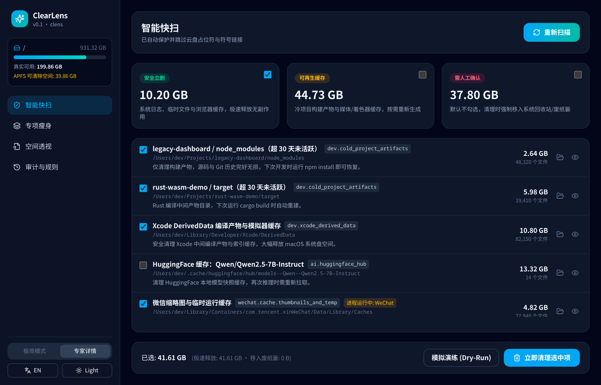
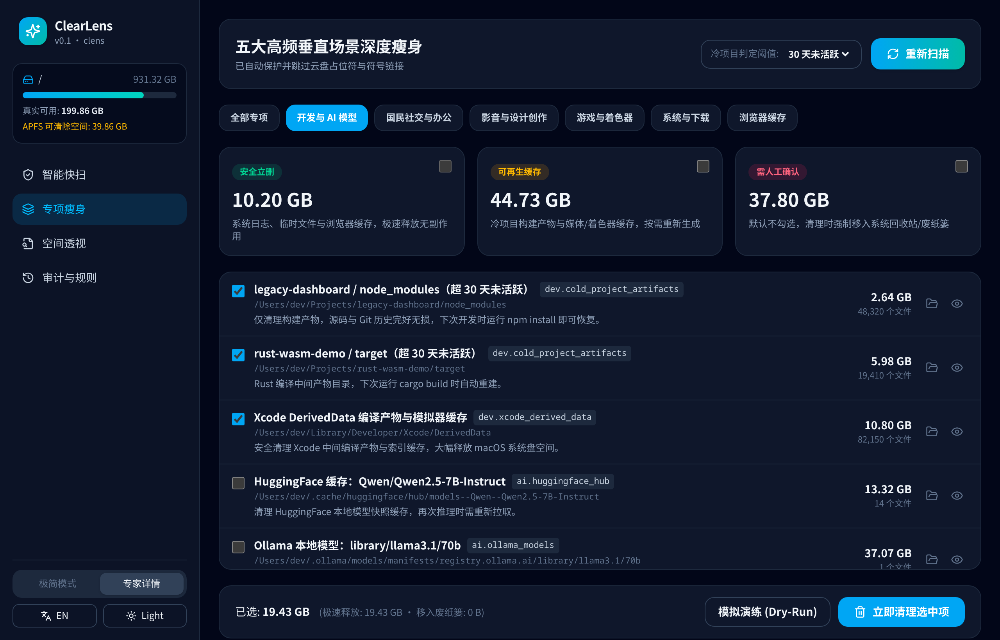
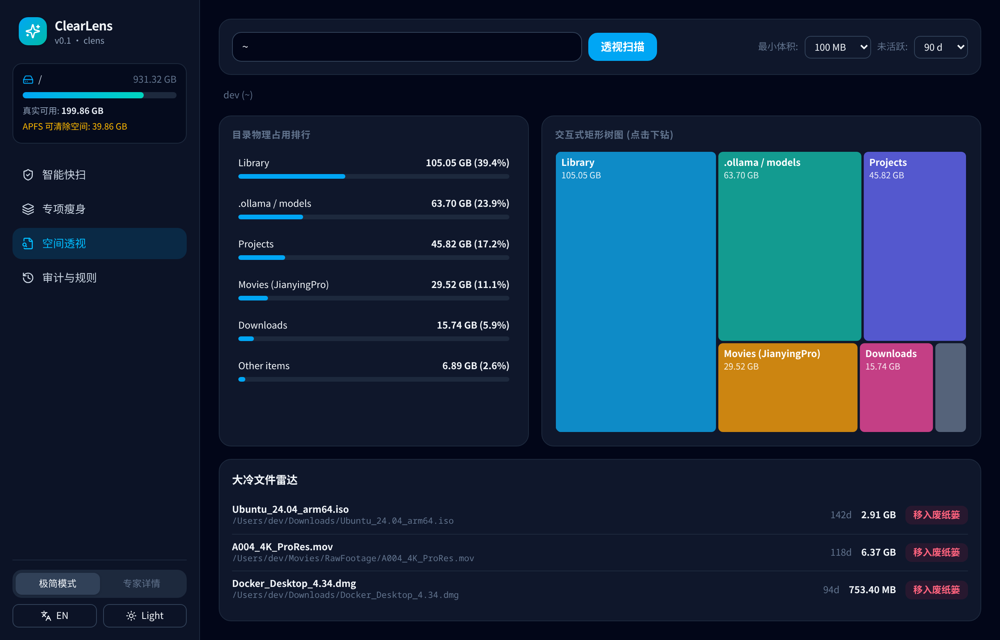
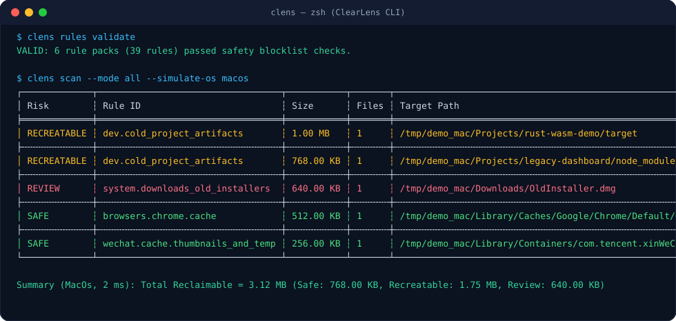

<div align="center">
  
  <h1>ClearLens (<code>clens</code>)</h1>
  <p>
    <strong>面向 Windows 与 macOS 的开源透明磁盘清理工具、开发者 / AI 缓存瘦身助手与 Space Lens 空间透视镜。</strong>
  </p>
  <p>
    <a href="./.github/workflows/ci.yml"></a>
    <a href="./LICENSE-MIT"></a>
    
    
  </p>
  <p>
    <a href="./README.md">English</a> | <strong>简体中文</strong>
  </p>
</div>

---

## 界面与 CLI 预览

### 智能快扫与专家详情模式（`极简模式` ↔ `专家详情` 双模式）
默认提供清晰的三档风险汇总卡片，方便大众一键安全清理；随时可切换至 **专家详情（Pro Inspector）** 查看每条命中的规则 ID、精确路径、删后影响说明、进程运行锁警告，以及一键定位或永久忽略。



### 五大高频垂直领域深度瘦身（开发 / AI 模型 / 社交办公 / 影音创作 / 游戏）
直击现代硬盘真正吃空间的大户——超期未活跃项目的 `node_modules` / Rust `target` / `.venv` / Xcode `DerivedData`、Ollama 与 HuggingFace 本地大模型权重、微信/企业微信/飞书/钉钉/QQ/Telegram 缓存（严格剥离聊天数据库与个人文档）、剪映/Adobe 渲染代理与 Steam/DirectX 着色器缓存。



### Space Lens 空间透视镜与大冷文件雷达
左侧按**真实物理分配大小**降序展示目录占比，右侧联动 60fps HTML5 Canvas **矩形树图（Squarified Treemap）** 支持点击逐层下钻；底部内置 **大冷文件雷达**，快速揪出遗忘的 `.iso`、`.dmg` 安装包与原始视频素材。



### `clens` 命令行工具
桌面端与 CLI 共享同一套 Rust 核心引擎与五道安全防线，适合极客日常使用、CI 规则校验与脚本自动化：

<div align="center">
  
</div>

---

## 为什么选择 ClearLens？

| 对比维度 | ClearLens (`clens`) | 传统商业清理软件 | 纯空间可视化工具 |
| :--- | :---: | :---: | :---: |
| **安装包与资源占用** | **约 10 MB（Tauri v2 + Rust）** | 150–400 MB，常带后台驻留服务 | 轻巧，但无自动化规则清理 |
| **规则透明度与演练** | **开源 TOML 规则 + `--dry-run`** | 黑盒报体积，容易误清登录态 | 仅手工逐个删文件 |
| **现代开发 / AI / 聊天生态** | **内置智能扫描器与精细排除规则** | 仍停留在清理 `%TEMP%` 阶段 | 无软件语义识别 |
| **软链接与云盘占位符保护** | **引擎底层强制拦截** | 易跟随软链或触发云盘下载 | 视工具而定 |
| **高风险项保护机制** | **`review_required` 强制进废纸篓** | 一刀切或直接删除 | 纯手工删除 |
| **开源与隐私** | **100% 开源免费 · 零遥测零广告** | 订阅昂贵或弹窗捆绑 | 多为闭源/收费 |

---

## 三档风险分流与五道防误删红线

ClearLens 为每一条扫描规则明确标注风险等级与删除路由：

- 🟢 **`safe`（默认勾选 → 极速物理清理）**：系统临时文件、历史崩溃日志、浏览器静态与 GPU 缓存（显式排除 `Cookies`、`Login Data`、`Bookmarks`、`History`）、IM 图片缩略图。
- 🟡 **`recreatable`（按场景勾选 → 极速清理或原生 prune）**：冷项目 `node_modules` / `target` / `.venv`、Xcode `DerivedData`、视频代理缓存、显卡着色器缓存。避免几十万碎文件卡死系统回收站，删后可随时重建。
- 🔴 **`review_required`（默认不勾选 → 强制移入回收站/废纸篓）**：下载目录超期安装包（`.dmg`/`.msi`/`.iso`）、Ollama 大模型权重、群聊自动缓存视频。即使在调用层请求物理删除，引擎也会强行改道至系统废纸篓。

每次扫描与清理都必须穿过 **5 道引擎级安全防线**（[`crates/clearlens-core/src/safety.rs`](./crates/clearlens-core/src/safety.rs)）：

1. **硬编码绝对禁区白名单**：引擎内置不可覆盖的保护规则，严禁匹配系统根目录（`/System`、`C:\Windows\System32`）、凭据密钥（`.ssh`、`.gnupg`、`.aws`、`.kube`、`Keychains`）、`.git` 元数据及用户个人资产目录（`Desktop`、`Documents`、`Pictures`、`Movies`、`Music`），仅允许在 `Documents` 下访问显式声明的软件缓存子目录（如微信 `FileStorage/Cache`）。
2. **符号链接与重解析点隔离**：全程基于 `symlink_metadata` / `FILE_FLAG_OPEN_REPARSE_POINT` 探测，绝不跟随 Symlink 或 Windows Junction 递归进入或删除外部真实数据。
3. **云盘仅在线占位符保护**：自动跳过 macOS `SF_DATALESS` / `.icloud` 存根与 Windows `FILE_ATTRIBUTE_RECALL_ON_DATA_ACCESS` / `OFFLINE` 占位文件，绝不读取文件内容，防止触发 OneDrive/iCloud 后台疯狂下载。
4. **硬链接去重与真实物理核算**：通过 32 分片 `(dev, ino)` 哈希集合对硬链接去重，并读取真实物理占用块大小（`blocks * 512` / `GetCompressedFileSizeW`）。
5. **运行中进程锁检测**：清理前通过 `sysinfo` 探测目标应用（如 Chrome、微信）是否正在运行，及时给出提示避免损坏数据库或清理失败。

---

## 仓库目录结构

```text
clearlens/
├── Cargo.toml                  # Cargo Workspace（clearlens-core, clearlens-cli, desktop）
├── rules/                      # 6 个开源可审计 TOML 规则包（39 条规则）+ JSON Schema
│   ├── schema/rule.schema.json
│   ├── system/os_junk.toml
│   ├── browsers/browsers.toml
│   ├── dev_ai/toolchains_and_ai.toml
│   ├── social_office/im_apps.toml
│   ├── creative_media/creative.toml
│   └── gaming/gaming_shaders.toml
├── crates/
│   ├── clearlens-core/         # 跨平台核心引擎：扫描、安全管线、规则执行、Space Lens、审计日志
│   └── clearlens-cli/          # 轻量命令行工具 `clens`
├── apps/
│   └── desktop/                # Tauri v2 + React + TypeScript + Tailwind CSS 桌面客户端
├── docker/                     # 隔离式多阶段测试与截图构建容器
├── tests/                      # 模拟 macOS 与 Windows 文件系统的端到端测试套件
└── docs/assets/                # 品牌 Logo、CLI 终端 SVG 与中英文界面截图
```

---

## 快速开始

### 1. 命令行使用（`clens`）

```bash
# 查看磁盘容量、真实可用空间及 macOS APFS 可清除空间
clens status

# 只读扫描全部专项（可自定义冷项目未活跃天数阈值）
clens scan --mode all --stale-days 30

# 模拟演练（默认 Dry-Run，不修改任何磁盘文件）
clens clean --risk safe,recreatable --dry-run

# 确认执行安全清理并写入本地审计日志（~/.clearlens/audit.jsonl）
clens clean --risk safe --apply

# 启动 Space Lens 分析物理占用并排查大冷文件（>= 500MB 且超 90 天未用）
clens lens ~/Projects --min-size-mb 500 --cold-days 90

# 校验内置或自定义的 TOML 规则包是否符合 Schema 与安全白名单
clens rules validate

# BLAKE3 三级漏斗查重与安全去重（自动跳过硬链接，每组强制保留至少 1 份原件）
clens duplicates ~/Downloads --min-size-kb 1024
clens duplicates-clean ~/Downloads --apply

# 应用联动卸载分析与历史孤儿残留猎手
clens apps
clens orphans --min-age-days 14 --apply
```

### 2. 推送 GitHub 自动构建 Windows 与 macOS 安装包

将本仓库推送至 GitHub 后，[`.github/workflows/release.yml`](./.github/workflows/release.yml) 会自动完成跨平台编译与打包：

- **推送至 `main` 分支（或在 Actions 页面手动点击 Run workflow）**：自动在 GitHub 云端构建 **macOS Universal `.dmg`**（同时原生支持 Apple Silicon 与 Intel）及 **Windows x64 `.msi` / NSIS `.exe`（内置中英安装语言选择）** 安装包与 `clens` 命令行包，直接可在 Actions 页面的 **Artifacts** 中下载安装。
- **推送版本标签（如 `git tag v0.1 && git push origin v0.1`）**：自动汇总全部 Windows / macOS 安装包、CLI 压缩包与 `SHA256SUMS.txt`，一键发布正式 **GitHub Release**。

```bash
# 本地桌面端开发与打包（macOS / Windows）
npm --prefix apps/desktop install
npm --prefix apps/desktop run tauri dev
npm --prefix apps/desktop run tauri build
```

### 3. Docker 隔离测试、`.deb` 打包安装与容器内文件清理验证（零宿主机副作用）

所有 Rust 单元与集成测试、模拟 macOS/Windows E2E 套件、前端校验，以及**真实 `.deb` / `.tar.gz` 打包 → 干净容器 `dpkg -i` 安装 → 容器内文件真实清理**均可在 Docker 中一键验证：

```bash
# 核心引擎、双端模拟 E2E 与前端单测套件
docker build -f docker/Dockerfile.test -t clearlens-test:v0.1 .
docker run --rm clearlens-test:v0.1

# 打包 .deb / .tar.gz、在无编译器的干净 Debian 容器中 dpkg 安装并执行全链路文件清理验证
docker build -f docker/Dockerfile.package-install -t clearlens-pkg-test:v0.1 .
docker run --rm clearlens-pkg-test:v0.1
```

---

## 参与贡献与安全政策

- 想为更多软件补充清理规则？欢迎阅读 [CONTRIBUTING.md](./CONTRIBUTING.md) 与 [rules/schema/rule.schema.json](./rules/schema/rule.schema.json)。
- 若发现任何规则存在误匹配用户个人数据的风险，请立即通过 [SECURITY.md](./SECURITY.md) 或 Safety 专用 Issue 模板反馈。
- 版本更新记录见 [CHANGELOG.md](./CHANGELOG.md)，社区行为准则见 [CODE_OF_CONDUCT.md](./CODE_OF_CONDUCT.md)。

## 开源协议

本项目基于 [MIT](./LICENSE-MIT) 或 [Apache-2.0](./LICENSE-APACHE) 双协议开源，你可以任选其一使用。
